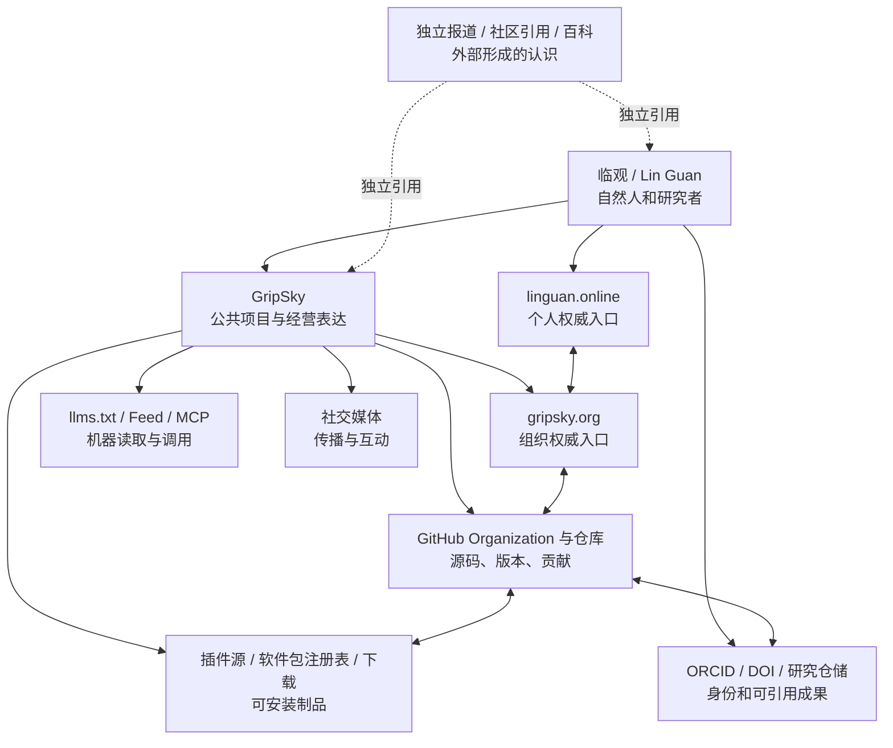

# GripSky 公共发现、实体与分发战略

> 状态：已确认，第一阶段实施中
> 日期：2026-08-06  
> 范围：定义站点、实体、渠道、制品、订阅与机器接口的关系，并记录已落地的公共发现入口。

### 2026-08-06 第一阶段落实

- 新增中英文 `/faq`，并在页面中提供与可见正文一致的 `FAQPage` 结构化数据；
- 新增 `/llms.txt`，为机器读取提供稳定定义、核心页面、公开源与更新入口；
- 新增 `/feed.xml`，把现有版本记录发布为 RSS，并在全站声明订阅入口；
- 在 `Organization` 之外建立独立的维护者 `Person` 实体，把 ORCID、个人 GitHub 与个人站归入自然人；
- 组织的 `sameAs` 只保留 GitHub Organization，worldview 仓库改作公开原则来源，避免把仓库误写成组织同一实体；
- 新增 `CITATION.cff`，记录组织站代码的作者、ORCID、版本与首选引用边界；
- 已核对 ORCID `0009-0009-9675-5355` 的公开记录：其中列出 GripSky 官网、个人 GitHub 与 GitHub Organization，构成第三方身份基础设施上的互相指向；
- 已确认 `gripskyworks/.github` 组织 Profile 仓库存在；其早期简介需要按本战略更新，而不再创建重复仓库。

## 一、战略判断

GripSky 已经具备组织站、公开世界观、技能目录、研究、版本、服务、邮件订阅和自托管叙事。下一阶段不是另造一个 SEO 外壳，而是把它们组织成一个能够被搜索、被引用、被安装、被订阅、被贡献和被验证的公共系统。

这套系统采用一个权威源、多种表达端点的结构：

- `gripsky.org` 解释 GripSky 是什么、如何运行、如何参与；
- GitHub 保存可审查的源码、版本、讨论和贡献记录；
- `linguan.online` 保存发起人临观的个人身份与经历，并指向 GripSky；
- 软件包注册表、插件源、MCP Registry、DOI 和 ORCID 等基础设施承担分发、引用与身份消歧；
- 社交渠道承担更新传播和真实互动；
- 独立媒体、论文、社区讨论与百科只记录已经形成的外部认识，不由 GripSky 自己制造背书。

不设“每周必须更新”的内容指标。世界观、技能、制品和研究发生实质变化时自然发布，并留下版本、日期、来源和影响范围。

## 二、公共实体图

### 三种来源不能混用

1. **自有权威源**：官网、个人站、官方 GitHub、官方文档、自己的 Wiki。适合说明“我们如何定义自己”。
2. **身份与制品基础设施**：ORCID、DOI、软件包注册表、MCP Registry。适合证明“这个人、版本或软件制品可以被稳定识别”。
3. **独立来源**：媒体报道、论文引用、真实用户案例、外部社区讨论、百科。适合证明“别人如何认识和评价 GripSky”。

自有页面互相链接能够消除歧义，但不能替代独立来源。自己维护的 Wiki 是文档，不是第三方背书。

## 三、核心实体与命名规则

### GripSky

- 公共名称固定为 `GripSky`，不强行创造中文译名。
- 官方定义应在官网、GitHub Organization、主要仓库和分发页面保持语义一致。
- 建议定义：`GripSky 是一套把公开世界观转化为可复用技能、自托管外置信息身躯与长期维护实践的个人系统项目。`
- 组织主页：`https://gripsky.org/`
- 源码组织：`https://github.com/gripskyworks`
- 发起人：临观 / Lin Guan。

### 临观 / Lin Guan

- `linguan.online` 是个人权威入口，不与组织站合并。
- 个人站连接 GripSky、个人 GitHub、ORCID 和公开研究成果。
- ORCID 属于自然人，不作为 GripSky Organization 的 `sameAs`；应挂在发起人 `Person` 实体及具体研究成果作者字段下。

### 经营主体

- 经营登记信息继续留在法律／经营主体页面，只公开核验后确有必要的字段。
- 公共项目、自然人和经营主体可以存在真实关系，但不得在结构化数据中粗暴合并成同一实体。

## 四、站点框架

现有六条主干保持不动：

- Worldview
- Skills
- External body
- Research
- Updates
- Services

新增内容收进以下框架。

### 1. FAQ

新增 `/faq`，首版只回答稳定、真实的问题：

1. GripSky 是什么？
2. GripSky 由谁维护，为什么建立？
3. GripSky 试图解决什么问题？
4. 谁适合使用或关注 GripSky？
5. 世界观如何变成技能？
6. 什么内容会开放，什么内容留在私有运行态？
7. GripSky 理想的运行方式是什么？
8. 自托管、托管服务和定制服务有什么区别？
9. 如何订阅更新或注册？
10. 如何参与研究和贡献？

FAQ 使用组织自身的陈述，不写成客服口吻，不为了关键词重复已经明确的段落。它可以提供机器可读结构，但不以搜索富摘要为目标。

### 2. Docs

新增 `/docs` 作为使用与运行说明入口，但只发布真实存在的能力：

- `/docs/getting-started`：GripSky 公开系统的阅读和使用顺序；
- `/docs/self-hosting`：安装、依赖、数据位置、升级、导出、移除；
- `/docs/skills`：技能卡、技能包和兼容性规则；
- `/docs/reference`：稳定的术语、格式和接口参考；
- `/docs/security`：公开边界、校验、签名、漏洞报告与凭据规则。

没有公开 API 时不建立空的 API Reference。接口稳定后再纳入。

### 3. Ecosystem

新增 `/ecosystem` 作为制品和机器接口总入口：

- `/ecosystem/plugins`：官方与社区插件；
- `/ecosystem/libraries`：不同编程语言的库和 SDK；
- `/ecosystem/mcp`：官网 MCP 的能力、连接方式和安全边界；
- `/ecosystem/downloads`：可下载版本、平台、校验值和签名；
- `/ecosystem/registry`：机器可读的插件、包和版本索引说明。

首页只需要出现一个进入 Ecosystem 的明确入口，不把每种制品都提升为一级导航。

### 4. Identity 与研究成果

扩充现有 `/about`，不另造宣传页：

- GripSky 的稳定定义、发起人、维护关系和公开边界；
- 官网、个人站、GitHub Organization、社交账户等官方入口；
- `/research/publications`：论文、技术报告、数据集、软件版本和 DOI；
- `/about/identity` 可在实体关系复杂后再建立，目前不必强行增加。

### 5. 注册、订阅与参与

明确区分四种关系：

| 关系 | 含义 | 是否收费 | 权威入口 |
| --- | --- | --- | --- |
| 注册 | 创建经邮箱验证的轻量身份 | 免费 | `/register` |
| 订阅 | 选择接收世界观、技能、兼容性、研究或服务更新 | 免费 | `/updates/subscribe` |
| 贡献 | 通过 GitHub 参与公开研究、文档或代码 | 免费协作 | `/research/contribute` |
| 委托 | 要求 GripSky 承担部署、定制、托管或维护责任 | 收费 | `/services`、`/contact` |

注册首版采用邮箱验证码或 magic link，不设置密码。注册成功不等于加入组织、成为研究成员或购买服务。

订阅必须明确选择主题和语言；不能因为“注册”而默认发送所有营销邮件。注册后可以管理订阅、退订、导出或删除自己的最小资料。GitHub 身份连接留作贡献者功能，不作为首版注册前提。

公开源码和下载不以注册为门槛。

## 五、外链与实体网络

### 第一圈：立即可以建立的自有互链

- `gripsky.org` → `linguan.online`、GitHub Organization、worldview 仓库；
- `linguan.online` → GripSky、个人 GitHub、ORCID；
- GitHub Organization → `gripsky.org`，并验证组织域名；
- GitHub Organization Profile README → 官网、Docs、主要仓库、参与方式；
- 每个主要仓库 README → 官网对应页面、文档、版本和维护者；
- 官网技能页、下载页和文档 → 对应仓库与正式 Release；
- 软件包页面 → 官网文档、源码仓库、许可证和问题入口；
- 官方社交账户 → 官网；官网只链接实际维护的账户。

`sameAs` 只用于真正代表同一实体的资料页。临观的个人 ORCID、个人站和个人社交账户应属于 `Person`，不能全部塞进 GripSky 的 `Organization.sameAs`。

### 第二圈：分发与持久身份

- GitHub Releases 作为源码制品的首要版本端点；
- `CITATION.cff` 描述作者、ORCID、版本、日期和推荐引用；
- 适合长期引用的软件、技术报告或数据集可通过 Zenodo 等仓储获得 DOI；
- npm、PyPI、crates.io 等注册表只在对应语言确有可安装包时开设；
- 插件源发布机器可读索引，同时保留来源、版本、许可证和校验值；
- 官网 MCP 稳定后可提交官方 MCP Registry。

### 第三圈：社交与社区

渠道不求数量，优先选择能够持续维护且与目标受众重叠的平台。每个渠道保持同名、同头像、同一句核心定义和官网链接。

建议区分：

- 组织账户：发布版本、研究、插件、文档和协作信息；
- 临观个人账户：表达个人判断、过程、经历以及与 GripSky 的关系；
- GitHub Discussions／Issues：承接可追踪的公开协作，不让讨论散落在只有算法流的社交平台。

### 第四圈：百科和独立来源

- Wikipedia 不是可以自行登记的企业目录。只有出现足够的独立可靠来源后，才适合准备条目；存在利益冲突时应公开关系并使用 Articles for Creation 或讨论页，而不是直接写组织宣传。
- Wikidata 也不是随意占位的品牌注册表。满足可识别性和引用要求后再建立条目，并用可靠来源支撑声明。
- GripSky 自建 Wiki 可以服务文档和概念演化，但归入自有来源。
- 真正提升独立权威的材料来自外部引用、第三方教程、用户案例、会议分享、论文引用和社区贡献。

## 六、插件、语言库与下载制品契约

任何进入官网生态目录的制品至少具备：

| 字段 | 要求 |
| --- | --- |
| 名称与标识 | 稳定、唯一，不随展示文案变化 |
| 类型 | 技能、插件、库、CLI、MCP、模板或数据集 |
| 当前版本 | 使用明确版本号和发布日期 |
| 成熟度 | 实验、预览、稳定、弃用 |
| 来源 | 指向唯一权威仓库 |
| 许可证 | 明确代码、文档和数据各自许可 |
| 维护者 | GripSky 或明确的外部维护者 |
| 运行环境 | 语言、运行时、平台与最低版本 |
| 安装方式 | 可复制、可验证、可卸载 |
| 依赖和权限 | 网络、文件、账号、设备与外部服务 |
| 安全边界 | 凭据位置、写操作、数据外发与失败方式 |
| 校验 | 下载文件的 SHA-256；重要版本再提供签名 |
| 更新路径 | Changelog、兼容性、迁移和退役说明 |

官网的 `/ecosystem/downloads` 是目录和说明层；实际二进制优先由 GitHub Releases 或对应注册表承载，避免在多个位置出现无法判断真假的“最新版”。如设置镜像，必须保留相同版本号和校验值。

## 七、官网 MCP 框架

MCP 第一阶段定位为 GripSky 公共系统的只读机器接口，既方便临观自己的 Agent 使用，也允许外部客户端读取公开内容。

### 公共入口

- 说明页：`https://gripsky.org/ecosystem/mcp`
- 建议远程端点：`https://mcp.gripsky.org/`
- 权威源码：GitHub Organization 内独立仓库或站点仓库中的清晰子项目；实施时再按依赖边界裁决。

### 第一阶段 Resources

- GripSky 官方定义和实体关系；
- 世界观目录与公开版本；
- 技能目录、技能卡和成熟度；
- 文档、研究问题、版本记录和下载清单；
- 服务范围与自托管边界。

建议使用稳定 URI，例如：

- `gripsky://about/definition`
- `gripsky://worldview/releases`
- `gripsky://skills/{skill-id}`
- `gripsky://updates/{version}`
- `gripsky://ecosystem/artifacts`

### 第一阶段 Tools

- `search_public_system`：搜索公开文档；
- `resolve_concept`：返回概念定义、来源和版本；
- `list_skills`：按类型、成熟度或开放状态列出技能；
- `get_skill_card`：读取指定技能的完整公共卡片；
- `list_releases`：读取发布和兼容性变化；
- `get_artifact`：返回下载、源码、许可证和校验信息。

第一阶段不提供写操作，不接触订阅者邮箱、联系人内容、私有 worldview、设备运行态、客户资料或生产凭据。注册和订阅继续通过专用网页接口完成，以便执行验证码、同意记录、速率限制和滥用防护。

第二阶段如增加写工具，应逐项加入认证、明确授权、调用日志、预算限制、幂等性和可撤销路径，不能因为挂在 MCP 下就默认可信。

## 八、机器发现与爬虫策略

### 公开策略

- 允许标准搜索引擎和 AI 搜索／训练爬虫访问公开正文、文档、技能、研究、版本和制品元数据；
- 不对公开知识设置只针对 AI 的额外阻断；
- `/api/`、账户管理、验证码、联系表单处理端点和任何私有运行接口不参与抓取；
- `robots.txt` 只表达抓取意愿，不承担访问控制。秘密和个人资料必须由认证与服务端授权保护。

当前可以继续使用 `User-agent: *` 的公共允许规则，不需要为了表态枚举每个机器人。另在项目文档中记录政策：GripSky 接受公开内容被搜索、索引和用于模型训练，但内容版权与许可证仍以页面、仓库或制品附带的许可为准。

### 机器入口

- `robots.txt`：抓取策略与 sitemap；
- `sitemap.xml`：规范 URL、双语对应和真实的逐页修改时间；
- `feed.xml`：版本、技能、研究和兼容性更新；
- `llms.txt`：实验性的精简机器导航，不宣称能换取引用；
- 页面级 JSON-LD：按真实内容使用 Organization、Person、BreadcrumbList、TechArticle、SoftwareSourceCode、Service、Dataset 等类型；
- 需要时提供与网页同源生成的 Markdown 表达，禁止手工维护两份逐渐分叉的正文；
- IndexNow：在页面新增、显著修改或删除后发送通知，不替代 sitemap，也不保证收录。

## 九、内容与引用契约

### 每个知识页面

- 一句可独立引用的定义；
- 内容所属主体；
- 作者或维护者；
- 发布日期与实际修改日期；
- 当前状态和适用边界；
- 来源、证据或上游版本；
- 稳定 canonical URL；
- 许可证或使用条件；
- 下一层阅读、源码或参与入口。

### 每个版本页面

- 版本号、日期和范围；
- 改了什么，以及为什么；
- 影响哪些技能、接口或运行方式；
- 是否存在破坏性变化；
- 升级、回退和移除方法；
- 对应 Git 提交、Release、制品和校验值；
- 维护者与引用方式。

### 每个研究页面

- 问题，而不是预先写好的结论；
- 已知事实、证据缺口和当前假设；
- 方法、材料和版本；
- 结果与失败记录；
- 作者、贡献者、ORCID 和可引用版本；
- GitHub Issue、Discussion 或仓库入口。

## 十、实施阶段

### 阶段 A：实体与框架

- 确认官方定义、实体名称和站点之间的归属；
- 校准官网、个人站和 GitHub 的双向链接；
- 建立 FAQ、Docs、Ecosystem、Register 的路径和内容模型；
- 明确注册、订阅、贡献、委托的界面边界；
- 明文记录公共爬虫允许策略；
- 复核中文服务端语言、逐页修改时间和结构化数据归属。

### 阶段 B：可安装、可引用、可订阅

- GitHub Organization Profile README、域名验证和主仓库资料；
- Release 模板、`CITATION.cff`、许可证与贡献说明；
- 插件／语言库／下载制品契约和机器索引；
- Feed、`llms.txt`、逐页版本与 IndexNow；
- 注册入口、订阅管理、导出和删除闭环；
- 只读官网 MCP 与说明页。

### 阶段 C：外部分发

- 按真实制品开设 npm、PyPI、crates.io 或其他语言注册表；
- 将适合长期引用的发布归档并取得 DOI；
- 完善临观 ORCID，并把实际研究成果、软件和数据集连接进去；
- 建立少量可持续维护的组织社交账户；
- MCP 稳定后进入官方 Registry。

### 阶段 D：独立实体共识

- 收集第三方教程、引用、报道、案例和公开讨论；
- 条件成熟后评估 Wikidata；
- 只有满足独立来源和利益冲突要求后才准备 Wikipedia 条目；
- 根据 Search Console、Bing、访问日志和 AI 引用测试修正定义与内容缺口。

这些阶段由真实能力和证据触发，不绑定人为更新频率。

## 十一、确认清单

实施前需要确认以下默认方案：

1. **官方定义**：采用“公开世界观 → 可复用技能 → 自托管外置信息身躯 → 长期维护实践”的定义。
2. **实体分离**：GripSky、临观和经营主体保持关联但不合并。
3. **站点结构**：保留现有六大主干，增加 FAQ、Docs、Ecosystem 和 Register。
4. **账户模型**：邮箱验证码／magic link、无密码、最小资料；注册不等于组织成员或客户。
5. **订阅模型**：注册与订阅可连贯完成，但主题和语言必须显式选择。
6. **制品权威端点**：源码和主要下载以 GitHub Release 为准，官网负责目录、解释和校验。
7. **插件与语言库命名**：实施前检查并确定统一命名空间，例如 `@gripsky/*`、`gripsky-*`。
8. **MCP**：说明页放在官网，远程端点使用 `mcp.gripsky.org`，第一阶段只读。
9. **爬虫**：允许公开搜索与 AI 抓取、搜索使用和训练；私有接口靠认证保护。
10. **百科策略**：自建 Wiki 可随时做文档；Wikipedia／Wikidata 等满足条件后再做，不把它们当注册渠道。
11. **发布节奏**：按实际世界观、技能、研究和制品变化发布，不设内容 KPI。

## 十二、不做的事

- 不批量生成泛化 SEO 博客；
- 不创建空 API Reference、空软件包或只有占位内容的社交账户；
- 不要求公开下载必须注册；
- 不把订阅者、贡献者和客户混成一种身份；
- 不用自有页面的互相引用冒充独立权威；
- 不为了结构化数据虚构组织规模、地址、评价、产品或研究成果；
- 不把 robots.txt 当安全边界；
- 不承诺 sitemap、IndexNow、Schema 或 llms.txt 必然带来排名或 AI 引用。

## 十三、权威源接口地图

AI 并不存在一张统一的“权威网站白名单”。它通常综合搜索索引、官方站点、身份标识、论文与软件登记库、代码和制品注册表，以及独立来源。自然人完全可以进入其中相当多的节点；关键是让每个节点证明它真正擅长证明的事情，并用稳定标识互相连接。

下面把入口分成四类：可立即创建、产生真实制品后创建、被数据库发现后认领、必须依赖独立来源。表中的“机器接口”是网站后续可以写进结构化数据、文档或 MCP 的稳定标识，不等于平台保证 AI 一定引用。

### A. 可立即建立的自然人身份节点

| 节点 | 人工入口 | 机器接口／稳定标识 | 现在能做什么 | 边界 |
| --- | --- | --- | --- | --- |
| 临观个人官网 | `https://linguan.online/` | `Person` JSON-LD、`sameAs`、`rel="me"` | 作为姓名、简介、项目关系和公开身份的第一权威源 | 自有来源，不算第三方独立报道 |
| ORCID | `https://orcid.org/register` | `https://orcid.org/<ORCID>`；Public API | 免费创建永久研究者标识，连接软件、论文、数据集、任职和个人网站 | 属于临观本人，不应作为 GripSky 组织的 `sameAs` |
| GitHub 个人资料 | `https://github.com/settings/profile` | GitHub 用户 URL 与 API | 连接个人站、ORCID 可引用成果和维护中的仓库 | 资料应与个人官网姓名和简介一致 |
| Bluesky 域名身份 | `https://bsky.app/` | 域名句柄与公开 AT Protocol 数据 | 可把 `linguan.online` 设为个人句柄、把 `gripsky.org` 设为组织句柄，以域名控制证明身份 | 只开设会持续使用的账号 |
| Mastodon 网站验证 | 选定实例注册；说明见 `https://docs.joinmastodon.org/user/profile/#verification` | 个人资料链接与官网 `rel="me"` | 用官网与社交资料双向验证身份 | 实例不是权威本身，域名关系才是可核验信号 |

ORCID 是这里最值得尽快建立的外部永久标识。它不要求先成为高校雇员；参与研究、学术或创新活动的人即可注册。后续官网、GitHub 的 `CITATION.cff`、Zenodo 和实际成果应统一使用同一个 ORCID。

### B. 可立即建立的 GripSky 组织节点

| 节点 | 人工入口 | 机器接口／稳定标识 | 现在能做什么 | 边界 |
| --- | --- | --- | --- | --- |
| GripSky 官网 | `https://gripsky.org/` | `Organization`、`WebSite`、`SoftwareSourceCode` 等 JSON-LD | 声明组织定义、维护者、项目、服务、软件和官方外部账号 | 不把经营主体、临观本人和 GripSky 合并成一个实体 |
| GitHub Organization Profile | `https://github.com/gripskyworks`；配置说明见 GitHub Organization Profile 文档 | Organization URL、仓库、Release、API | 建立公开组织简介、主仓库、文档和制品来源 | `.github/profile/README.md` 应与官网定义一致，但不必逐字重复 |
| GitHub 域名验证 | Organization Settings → Verified domains；说明：`https://docs.github.com/en/organizations/managing-organization-settings/verifying-or-approving-a-domain-for-your-organization` | DNS TXT 与 GitHub Verified 标记 | 证明 `gripsky.org` 与 GitHub 组织之间的控制关系 | 需要组织权限与 DNS 控制权 |
| Google Search Console | `https://search.google.com/search-console/` | 域名资源、sitemap、URL Inspection | 证明站点控制权，查看 Google 抓取和索引状态 | 这是搜索管理接口，不是知识面板创建接口 |
| Bing Webmaster Tools | `https://www.bing.com/webmasters/` | 域名资源、sitemap、URL Inspection、IndexNow | 管理 Bing/Copilot 所依赖的公开搜索发现路径 | 可以从 Search Console 导入；仍需内容可抓取 |

首页、关于页和 GitHub 应形成明确双向关系：GripSky 官网链接 GitHub 组织；GitHub 组织资料填写 `https://gripsky.org/`；临观个人站声明自己是维护者；GripSky 的 `Organization` 数据用 `founder` 或 `member` 指向临观的 `Person`，而不是把两者写成同一对象。

### C. 有真实制品后即可进入的登记库

| 节点 | 发布／登记入口 | 生成的权威标识 | 适合 GripSky 的内容 |
| --- | --- | --- | --- |
| GitHub Citation | 仓库根目录加入 `CITATION.cff`；说明：`https://docs.github.com/en/repositories/managing-your-repositorys-settings-and-features/customizing-your-repository/about-citation-files` | 可机读作者、版本、ORCID、DOI 和首选引用方式 | 技能框架、软件、规范或研究仓库 |
| Zenodo | `https://zenodo.org/signup/`；GitHub 集成：`https://help.zenodo.org/docs/github/` | DOI、版本记录、元数据；REST API、OAI-PMH | 稳定版本的软件、技术报告、数据集、规范和研究材料 |
| Software Heritage | `https://archive.softwareheritage.org/save/` | SWHID 永久源码标识；公开 API | 已公开 Git 仓库的不可变源码归档与精确引用 |
| npm | `https://www.npmjs.com/signup`；组织说明：`https://docs.npmjs.com/creating-an-organization/` | `@gripsky/<package>` 包名、版本和注册表元数据 | Node.js SDK、插件、CLI、前端组件 |
| PyPI | `https://pypi.org/account/register/`；Trusted Publishing：`https://docs.pypi.org/trusted-publishers/` | `gripsky-*` 包名、版本、项目 URL 和元数据 | Python SDK、自动化工具、MCP 客户端或服务端组件 |
| crates.io | `https://crates.io/`（GitHub 登录） | crate 名称、版本和元数据 | 实际存在且有维护计划的 Rust 库或工具 |
| GitHub Container Registry | 由 GitHub Actions 发布到 `ghcr.io` | `ghcr.io/gripskyworks/<image>:<version>` | 可自托管服务、MCP 服务端、参考部署镜像 |
| MCP Official Registry | `https://registry.modelcontextprotocol.io/`；发布说明：`https://modelcontextprotocol.io/registry/quickstart` | MCP server 元数据与命名空间；Registry API | 已有公开远程端点或可安装包的 GripSky MCP 服务 |

这些登记库不能靠空占位提高权威。每个条目至少应具备：明确用途、版本、许可证、作者／组织、源码、文档、变更记录、发布日期、校验或可复现安装方式。命名空间是否可用要在实施时逐个平台检查，不能在策略文档中预设已经占有。

推荐的单次发布链条是：

1. GitHub 仓库合并可发布版本；
2. 创建带版本号和变更说明的 GitHub Release；
3. 发布语言包或容器制品；
4. 由 Zenodo 归档该 Release 并生成 DOI；
5. 把 DOI、ORCID 和仓库地址回填到 `CITATION.cff`、官网制品页和 README；
6. 对需要永久源码引用的仓库请求 Software Heritage 保存；
7. 若它是 MCP 服务，再提交 MCP Registry。

由此形成 `自然人 ORCID → 软件作者 → GitHub Release → 包注册表 → DOI／SWHID → 官网目录` 的可核验链条。

### D. 先有成果，数据库发现后再认领或纠错

| 节点 | 入口 | 正确进入方式 | GripSky 当前策略 |
| --- | --- | --- | --- |
| Google Scholar | 建立资料：`https://scholar.google.com/citations?view_op=new_profile` | 先有论文、技术报告或其他 Scholar 能识别的学术成果，再建立并维护公开作者资料 | 有合适成果后使用；不把普通官网文章硬包装成论文 |
| Semantic Scholar | `https://www.semanticscholar.org/author` | 先由论文索引生成作者页，再认领、补主页和 ORCID、纠正论文归属 | 出现作者页后认领，不存在时不造空页 |
| OpenAlex | API：`https://api.openalex.org/`；纠错：`https://help.openalex.org/hc/en-us/requests/new` | 它从 Crossref、DataCite、ORCID、Zenodo、机构库等聚合；没有直接“新建作者”按钮 | 通过 ORCID、DOI 和开放仓储进入，聚合后再纠错 |
| Google Knowledge Panel | 认领说明：`https://support.google.com/knowledgepanel/answer/7534902` | Google 自动建立后，搜索实体并使用“认领此知识面板”验证身份 | 没有人工创建入口；出现后再认领和反馈 |

Google Business Profile 不是 GripSky 的替代入口。Google 明确排除纯线上品牌、组织和业务；只有真实面向客户的线下地点或符合条件的上门服务业务才应创建。不能为了知识面板虚构营业地点。

### E. 需要独立来源或额外资格的公共知识节点

| 节点 | 入口 | 条件 | 处理原则 |
| --- | --- | --- | --- |
| Wikidata | 新建项目：`https://www.wikidata.org/wiki/Special:NewItem`；收录条件：`https://www.wikidata.org/wiki/Wikidata:Notability` | 实体需要满足可识别性和收录条件，并由可靠来源支撑陈述 | 条件成熟后建立 Person／Organization／Software 条目；不用自有网页循环证明自己 |
| Wikipedia | Articles for Creation：`https://en.wikipedia.org/wiki/Wikipedia:Articles_for_creation` | 需要多个独立、可靠、具有实质报道的二手来源，并处理利益冲突 | 临观本人不直接写宣传条目；披露关联，通过 AfC 或讨论页提交基于独立来源的草稿 |

自建 Wiki、官网 Docs 和 GitHub Wiki 都是有价值的第一方知识源，但它们不能替代 Wikipedia 的独立来源要求。对 AI 来说，它们仍可作为官方定义和技术事实的引用对象，因此值得建设，只是证据类型不同。

### F. AI 引用与爬虫的实际接口

主流 AI 搜索通常没有“把我的网站登记成权威源”的人工表单。其入口是公开网页、搜索索引、爬虫权限、稳定 URL、结构化事实和上述外部登记库。

| 系统 | 对外接口 | GripSky 应做什么 | 不存在的东西 |
| --- | --- | --- | --- |
| ChatGPT Search | `OAI-SearchBot`；说明：`https://developers.openai.com/api/docs/bots` | 在 `robots.txt` 和网络层允许搜索爬虫，保持页面可直接读取并进入 Google/Bing 等公开索引 | 没有“提交给 ChatGPT 引用”的站长后台；`GPTBot` 训练控制与搜索控制是两回事 |
| Claude | `Claude-SearchBot`、`ClaudeBot`、`Claude-User`；说明：`https://support.anthropic.com/en/articles/8896518-does-anthropic-crawl-data-from-the-web-and-how-can-site-owners-block-the-crawler` | 不阻止公开搜索／用户抓取；需要时分别声明训练和搜索策略 | 没有公开的权威源申请表 |
| Perplexity | `PerplexityBot`、`Perplexity-User`；说明：`https://docs.perplexity.ai/docs/resources/perplexity-crawlers` | 允许 robots 与防火墙中的官方爬虫，保证正文和引用链接可达 | 没有内容质量背书式提交入口 |
| Gemini / Google AI | Google Search 抓取与 Search Console；`Google-Extended` 说明：`https://developers.google.com/crawling/docs/crawlers-fetchers/google-common-crawlers` | 通过 Search Console、sitemap、结构化数据和正常搜索收录建立发现路径 | `Google-Extended` 不控制普通 Google Search 排名，也不是提交表单 |
| Copilot / Bing | Bing Webmaster Tools、sitemap、IndexNow | 让 Bing 持续发现新增和修改页面 | IndexNow 只通知 URL 变化，不保证收录或引用 |

因此“允许爬虫”的具体策略应分开表达：允许搜索发现、允许用户请求时抓取、允许或拒绝训练，可以采用不同规则。GripSky 当前选择公开组织内容尽量开放，但登录、验证码、邮件发送、管理端和私人资料始终由认证、限流和网络策略保护，不能依赖爬虫声明。

### G. GripSky 的推荐进入顺序

1. **现在即可完成**：临观个人站、GripSky 官网和 GitHub 双向链接；建立 ORCID；验证 GitHub Organization 域名；统一名称、简介、Logo 和维护者关系；公开明确的爬虫政策。
2. **第一批真实制品发布时完成**：`CITATION.cff`、GitHub Release、语言包或容器、Zenodo DOI、Software Heritage SWHID，并在官网 Ecosystem 目录集中展示。
3. **有研究型成果后完成**：维护 Google Scholar；等待 OpenAlex 和 Semantic Scholar 聚合后认领、补充和纠错。
4. **官网 MCP 可公开使用后完成**：把说明、隐私、版本、源码和端点补齐，再进入 MCP Official Registry。
5. **出现足够独立来源后完成**：评估 Wikidata 和 Wikipedia；先积累事实与第三方引用，不提前制造百科存在感。
6. **知识面板出现后完成**：由临观或组织完成 Google 认领，把官网和稳定外部身份作为验证依据。

### H. 每个外部节点必须回填的共同字段

- 统一显示名及中英文别名；
- 一句事实性定义，而不是广告口号；
- 官方网站和源码地址；
- 临观与 GripSky 的准确角色关系；
- Logo／头像及稳定图片 URL；
- ORCID、DOI、SWHID、包名等适用的永久标识；
- 许可证、版本、发布日期和最后修改时间；
- 可引用说明、联系与安全报告入口；
- 其他官方节点的双向链接。

官网后续应维护一份内部“实体与标识登记表”，作为 JSON-LD、页脚、About、GitHub Profile、`CITATION.cff`、包元数据、MCP Registry 和社交资料的共同来源，避免各处定义随时间分叉。

## 参考规则

- Google Search 基础：https://developers.google.com/search/docs/fundamentals/seo-starter-guide
- Google sitemap：https://developers.google.com/search/docs/crawling-indexing/sitemaps/build-sitemap
- OpenAI 爬虫：https://developers.openai.com/api/docs/bots
- Google AI 使用控制：https://developers.google.com/crawling/docs/crawlers-fetchers/google-common-crawlers
- llms.txt 提案：https://llmstxt.org/
- GitHub Organization Profile：https://docs.github.com/en/organizations/collaborating-with-groups-in-organizations/customizing-your-organizations-profile
- GitHub Citation：https://docs.github.com/en/repositories/managing-your-repositorys-settings-and-features/customizing-your-repository/about-citation-files
- GitHub 域名验证：https://docs.github.com/en/organizations/managing-organization-settings/verifying-or-approving-a-domain-for-your-organization
- ORCID 研究者说明：https://info.orcid.org/researchers/
- ORCID Public API：https://info.orcid.org/what-is-orcid/services/
- Zenodo GitHub 集成：https://help.zenodo.org/docs/github/
- Software Heritage 文档：https://docs.softwareheritage.org/
- Google Scholar 作者资料：https://scholar.google.com/intl/en/scholar/citations.html
- Semantic Scholar 作者页认领：https://www.semanticscholar.org/author
- OpenAlex 数据来源：https://docs.openalex.org/api-entities/works/work-object
- npm Organization：https://docs.npmjs.com/creating-an-organization/
- PyPI Trusted Publishing：https://docs.pypi.org/trusted-publishers/
- MCP 能力模型：https://modelcontextprotocol.io/docs/learn/server-concepts
- MCP Official Registry：https://modelcontextprotocol.io/registry/about
- Anthropic 爬虫说明：https://support.anthropic.com/en/articles/8896518-does-anthropic-crawl-data-from-the-web-and-how-can-site-owners-block-the-crawler
- Perplexity 爬虫说明：https://docs.perplexity.ai/docs/resources/perplexity-crawlers
- Google Knowledge Panel 认领：https://support.google.com/knowledgepanel/answer/7534902
- Wikipedia 利益冲突：https://en.wikipedia.org/wiki/Wikipedia:Conflict_of_interest
- Wikidata 收录条件：https://www.wikidata.org/wiki/Wikidata:Notability
